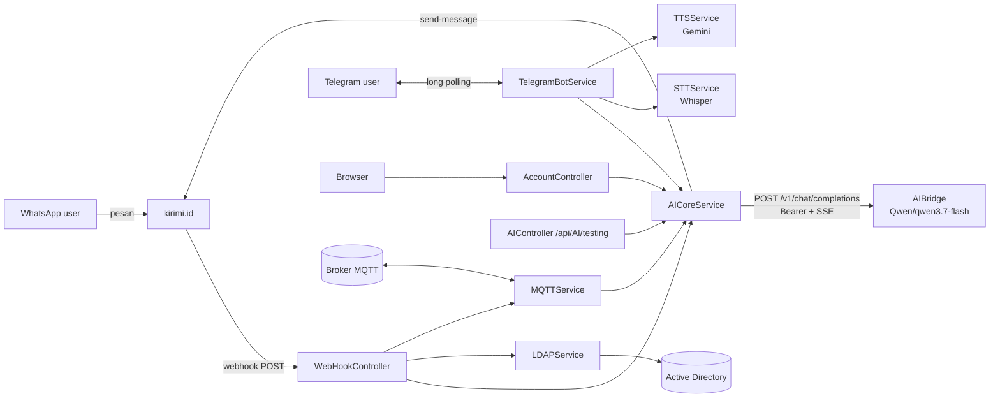
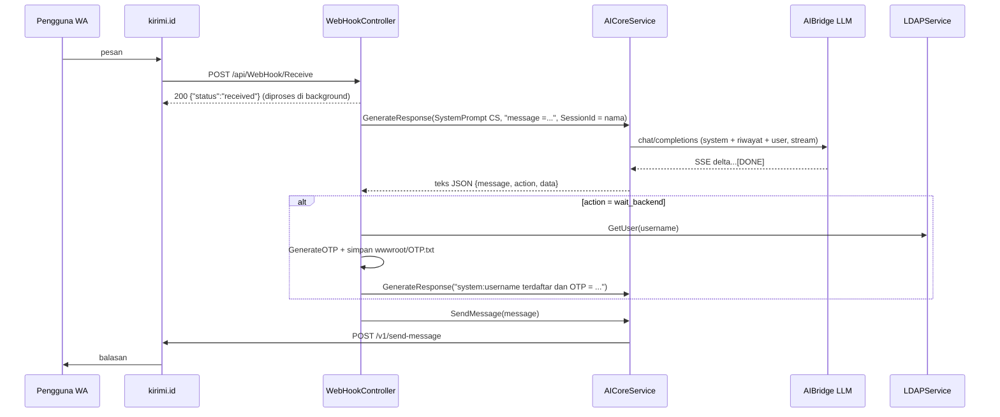
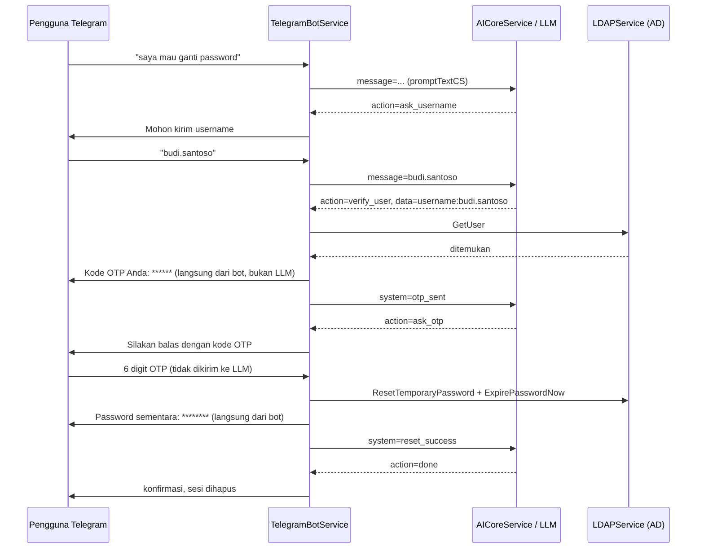
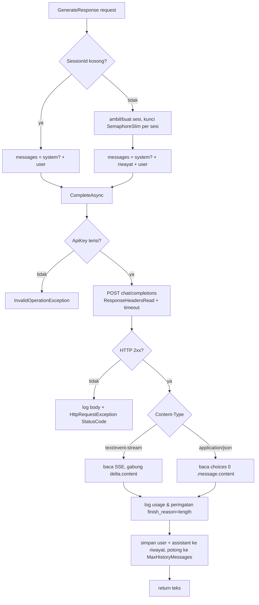

# CS_AI — Dokumentasi Proyek

## 1. Tujuan dan Gambaran Umum

CS_AI adalah backend ASP.NET Core yang menjalankan **asisten AI internal** untuk tiga kebutuhan:

1. **Customer Service via WhatsApp**: alur reset password akun perusahaan (Active Directory) dengan verifikasi OTP. Pesan WhatsApp masuk lewat webhook kirimi.id.
2. **Customer Service via Telegram (voice)**: pengguna mengirim voice note, sistem mengubahnya menjadi teks (Whisper), meminta jawaban LLM, lalu membalas dengan audio (Gemini TTS). Mendukung alur cek tagihan dan pembuatan tiket alamat.
3. **Asisten monitoring server**: membaca status IIS/server dari MQTT, meminta LLM merangkum kondisi dan memberi saran, lalu mengirim hasilnya ke WhatsApp.

Semua pemanggilan LLM dipusatkan di `Services/AICoreService.cs`. Service ini memanggil gateway OpenAI-compatible AIBridge (`https://console-aibridge.visionet.co.id/v1`) dengan model `Qwen/qwen3.7-flash`. Nama model di template awal, `deepseek-ai/DeepSeek-V4-Flash`, ditolak AIBridge (`invalid_model`) untuk key yang dipakai, sehingga diganti di konfigurasi.

## 2. Teknologi dan Dependensi

| Komponen | Versi / Keterangan |
|---|---|
| Runtime | .NET 8 (`net8.0`), ASP.NET Core MVC + Web API |
| `Telegram.Bot` | 22.9.6.1 — bot Telegram (long polling) |
| `Whisper.net` + `Whisper.net.Runtime` | 1.9.0 — speech-to-text, model `wwwroot/ggml-small.bin` |
| `Google.GenAI` | 1.6.1 — text-to-speech (Gemini) |
| `MQTTnet` | 4.3.7.1207 — komunikasi dengan agent server (broker MQTT) |
| `System.DirectoryServices(.AccountManagement)` | 10.0.2 — LDAP / Active Directory (khusus Windows) |
| `Swashbuckle.AspNetCore` | 6.6.2 — Swagger UI |
| `ffmpeg.exe` | Disertakan di `wwwroot/ffmpeg/` untuk konversi audio OGG ↔ WAV |
| LLM | AIBridge `/v1/chat/completions` (OpenAI-compatible), streaming SSE |

Integrasi LLM tidak menambah paket NuGet. Semuanya memakai `HttpClient` (`IHttpClientFactory`) dan `System.Text.Json` bawaan .NET.

## 3. Struktur Proyek

```
CS_AI/
├── Program.cs                     # Komposisi DI, konfigurasi Kestrel (localhost:5000), Swagger
├── appsettings.json               # Konfigurasi (termasuk bagian "LLM")
├── CS_AI.csproj                   # Definisi proyek + UserSecretsId
├── Controllers/
│   ├── AccountController.cs       # Halaman MVC reset password (Razor) + notifikasi AI
│   ├── ActiveDirectoryController.cs
│   ├── LMStudioAPI.cs             # AIController: api/AI/testing, sendmessage, PublishandWait
│   ├── UserController.cs          # api/User: getUser, resetPassword, changePassword, STTTest
│   └── WebHookController.cs       # api/WebHook/Receive: webhook WhatsApp (kirimi.id)
├── Models/                        # WebhookWA, UserModel
├── Services/
│   ├── AICoreService.cs           # Klien LLM + memori sesi + pengirim WhatsApp
│   ├── TelegramService.cs         # TelegramBotService (hosted service)
│   ├── MQTTService.cs             # Klien MQTT + PublishAndWaitAsync
│   ├── LDAPService.cs             # Lookup user Active Directory
│   ├── STTService.cs              # Whisper speech-to-text
│   ├── TTSService.cs              # Gemini text-to-speech
│   └── LmStudioService.cs         # (seluruhnya dikomentari, warisan LM Studio)
├── Views/Account/                 # ResetPassword.cshtml, ResetSuccess.cshtml
├── wwwroot/                       # ffmpeg, model Whisper, OTP.txt, database.txt, tts/, voices/
└── docs/README.id.md              # Dokumen ini
```

## 4. Arsitektur dan Tanggung Jawab Komponen

| Komponen | Lifetime DI | Tanggung jawab |
|---|---|---|
| `AICoreService` | Singleton | Membangun request chat completion, membaca stream SSE, menyimpan riwayat percakapan per sesi, mengirim pesan WhatsApp (kirimi.id). |
| `WebHookController` | Per request | Menerima event WhatsApp, menjalankan alur reset password (LLM → LDAP → OTP), dan perintah `check iis` / `restart:<site>` / `check server`. |
| `TelegramBotService` | Singleton + Hosted | Long polling Telegram. Voice → STT → LLM → TTS (balasan audio). **Chat teks** → LLM (balasan teks) untuk billing, laporan jalan rusak, dan ganti/reset password AD. Cek tagihan dari `wwwroot/database.txt`. Perintah `/start`, `/time`, `/checkserver`, `/reset`. |
| `MQTTService` | Singleton | Subscribe ke topik status server; meneruskan kondisi server ke LLM; `PublishAndWaitAsync` untuk request/response via MQTT. |
| `AccountController` | Per request | Form reset password (Razor) dan notifikasi hasil lewat LLM + WhatsApp. |
| `LDAPService` | Scoped | Lookup user di Active Directory. |
| `STTService` / `TTSService` | Singleton | Whisper (lokal) dan Gemini TTS. |



### Alur reset password WhatsApp



### Bot Telegram — chat teks

Pesan teks yang bukan perintah (`/start`, `/time`, `/checkserver`, `/reset`) diproses oleh `HandleTextAsync`. Pesan dikirim ke LLM dengan system prompt `promptTextCS`, dengan sesi per `chatId`. LLM membalas JSON `{message, action, data}`; kode bot membaca `action` lalu menjalankan langkah backend:

| `action` dari LLM | Yang dilakukan bot |
|---|---|
| `wait_backend` (`data = billing_number:...`) | Kirim pesan tunggu, cari nominal di `wwwroot/database.txt`, kirim `system=billing_found:<nominal>` / `system=billing_not_found` ke LLM, lalu kirim jawabannya |
| `create_ticket` (`data = address:...`) | Buat nomor tiket acak 6 digit, kirim ke pengguna, hapus sesi |
| `verify_user` (`data = username:...`) | Cari user di AD (`LDAPService.GetUser`). Jika ada: buat OTP, kirim ke chat, lalu `system=otp_sent`. Jika tidak: `system=user_not_found` |
| `done` | Kirim pesan, hapus sesi |
| lainnya | Kirim `message` apa adanya |

Kalau ada OTP yang menunggu dan pengguna mengirim 6 digit angka, pesan itu **tidak dikirim ke LLM**. Bot langsung memverifikasinya:

- OTP salah → `system=otp_invalid`. Setelah 3 kali salah atau lewat 5 menit → `system=otp_expired` dan state dihapus.
- OTP benar → bot membuat password sementara 12 karakter (huruf besar, huruf kecil, angka, simbol; `RandomNumberGenerator`). Password disetel di AD lewat `LDAPService.ResetTemporaryPassword`, yang juga memanggil `ExpirePasswordNow`, sehingga pengguna wajib mengganti password saat login berikutnya. Password dikirim langsung ke chat, lalu `system=reset_success` / `system=reset_failed`.



> **⚠️ Mode DEMO — tidak aman untuk produksi.** OTP ditampilkan di chat yang sama dengan permintaan reset, jadi OTP **tidak membuktikan identitas**: siapa pun yang tahu sebuah username dapat me-reset password AD orang tersebut lewat bot. Sebelum dipakai di produksi, ganti verifikasinya (misalnya cocokkan nomor HP dari tombol "Bagikan kontak" Telegram dengan nomor HP di AD, atau kirim OTP ke email AD). Setiap reset dicatat di log level Warning (username + chatId).

Rancangan keamanan yang tetap berlaku:

- OTP, password sementara, dan input OTP tidak pernah dikirim ke LLM.
- OTP dan password tidak ditulis ke log.
- State OTP disimpan per chat di memori, bukan di `wwwroot/OTP.txt` yang dipakai bersama.

Startup bot dibuat tahan gagal. Jika `api.telegram.org` tidak terjangkau, error dicatat (`Telegram bot cannot reach Telegram API, retrying in 30 seconds`) dan bot mencoba lagi setiap 30 detik. Aplikasi (webhook WhatsApp, halaman web, API) tetap berjalan.

## 5. Alur Pemanggilan LLM

Implementasi mengikuti template OpenAI Python SDK yang diberikan:

| Template | Implementasi .NET |
|---|---|
| `base_url="https://console-aibridge.visionet.co.id/v1"` | `LLM:BaseUrl` → `HttpClient.BaseAddress` |
| `api_key=...` | `LLM:ApiKey` → header `Authorization: Bearer <key>` |
| `client.chat.completions.create(...)` | `POST {BaseUrl}/chat/completions`, `Content-Type: application/json` |
| `model` | `LLM:Model` (bisa ditimpa `GenerateResponseRequest.Model`) |
| `messages` (system + user) | `system` dari `SystemPrompt` (opsional), riwayat sesi, lalu `user` dari `Prompt` |
| `temperature=0.7` | `LLM:Temperature` |
| `max_tokens=150` | `LLM:MaxTokens` |
| `stream=True` | selalu `"stream": true`; SSE dibaca baris per baris dan `choices[0].delta.content` digabung |

Contoh body yang dikirim:

```json
{
  "model": "Qwen/qwen3.7-flash",
  "messages": [
    { "role": "system", "content": "Anda adalah Customer Service perusahaan ..." },
    { "role": "user", "content": "message =halo" }
  ],
  "temperature": 0.7,
  "max_tokens": 150,
  "stream": true
}
```

Format stream yang dibaca:

```
data: {"choices":[{"index":0,"delta":{"content":"{\"message\":"}}]}
data: {"choices":[{"index":0,"delta":{"content":"\"Halo...\"}"},"finish_reason":"stop"}],"usage":{...}}
data: [DONE]
```



### Memori percakapan

Backend AI Core lama menyimpan riwayat di sisi server per `UserId`. Endpoint chat completions bersifat stateless, jadi riwayat kini disimpan **di memori proses** oleh `AICoreService`:

- Kunci sesi = `GenerateResponseRequest.SessionId`. Yang dipakai saat ini: nama pengirim WA, `chatId` Telegram, `Session6` (cek IIS), `Session7` (alert MQTT), `Caesar` (notifikasi reset web).
- Yang disimpan hanya pesan `user` dan `assistant`. System prompt dikirim ulang di setiap panggilan dan tidak ikut disimpan.
- Riwayat dibatasi `LLM:MaxHistoryMessages` (pesan terlama dibuang berpasangan). Sesi yang tidak aktif lebih dari `LLM:SessionTtlMinutes` dihapus.
- `ClearSession(sessionId)` menggantikan pemanggilan lama `api/AI/deleteSession` (Telegram setelah tiket/tagihan selesai dan perintah `/reset`).
- Panggilan pada sesi yang sama diserialisasi (satu per satu) agar urutan riwayat konsisten.
- **Riwayat hilang ketika aplikasi di-restart** dan tidak dibagi antar-instance. Jika aplikasi dijalankan lebih dari satu instance, dibutuhkan store terdistribusi (belum diimplementasikan).

### Input gambar

`GenerateResponseRequest.ImagePath` masih diterima (misalnya dari `api/AI/testing`), tetapi **tidak dikirim** ke LLM dan hanya dicatat sebagai warning. Dukungan gambar pada model AIBridge yang dipakai belum terkonfirmasi.

## 6. Konfigurasi dan Variabel Lingkungan

Bagian `LLM` di `appsettings.json`:

| Key | Default | Keterangan |
|---|---|---|
| `LLM:BaseUrl` | `https://console-aibridge.visionet.co.id/v1` | Base URL gateway OpenAI-compatible |
| `LLM:Model` | `Qwen/qwen3.7-flash` | Model default. Harus ID persis yang terdaftar untuk API key di console AIBridge; AIBridge tidak menyediakan endpoint `/v1/models`. |
| `LLM:Temperature` | `0.7` | Sesuai template |
| `LLM:MaxTokens` | `150` | Sesuai template. Jika jawaban terpotong, log menampilkan *"LLM reply was truncated"*; naikkan nilai ini. |
| `LLM:TimeoutSeconds` | `120` | Batas total satu request, termasuk membaca seluruh stream |
| `LLM:MaxHistoryMessages` | `20` | Jumlah pesan riwayat per sesi |
| `LLM:SessionTtlMinutes` | `60` | Sesi tidak aktif lebih lama dari ini akan dihapus |
| `LLM:ApiKey` | — | **Wajib.** Jangan ditulis di `appsettings.json` atau dikomit. |

Mengisi API key:

```bash
dotnet user-secrets set "LLM:ApiKey" "<API_KEY>" --project D:\Code\2026\AI_Internal\CS_AI
```

Atau lewat environment variable di server (nama key memakai `__` sebagai pemisah):

```bash
setx LLM__ApiKey "<API_KEY>" /M
```

Semua key `LLM:*` lain juga bisa ditimpa dengan environment variable, misalnya `LLM__Model` atau `LLM__MaxTokens`.

### Token bot Telegram

| Key | Keterangan |
|---|---|
| `Telegram:BotToken` | **Wajib** untuk bot Telegram (didapat dari @BotFather). Jika kosong, bot dinonaktifkan dan log menampilkan `Telegram:BotToken is not configured, Telegram bot is disabled`; bagian aplikasi lain tetap berjalan. |

```bash
dotnet user-secrets set "Telegram:BotToken" "<BOT_TOKEN>" --project D:\Code\2026\AI_Internal\CS_AI
```

Di server, gunakan environment variable `Telegram__BotToken`. Saat mengganti bot, cukup ubah nilai ini lalu restart aplikasi; kode tidak perlu diubah.

> **Catatan keamanan.** Selain LLM, beberapa kredensial lain masih tertulis langsung di source/config: kredensial Active Directory dan API key Gemini di `appsettings.json`, kredensial AD di `LDAPService.cs`, serta secret dan device kirimi.id di `AICoreService.cs` dan `LMStudioAPI.cs`. Sesuai keputusan, kredensial tersebut tidak dipindahkan pada perubahan ini. Disarankan memindahkannya ke user-secrets/env var dan melakukan rotasi.

## 7. Instalasi dan Menjalankan

Prasyarat: Windows (dibutuhkan LDAP dan `ffmpeg.exe`), .NET SDK 8 atau lebih baru, akses jaringan ke AIBridge, kirimi.id, Telegram, broker MQTT, dan Domain Controller.

```bash
cd D:\Code\2026\AI_Internal\CS_AI
dotnet restore
dotnet user-secrets set "LLM:ApiKey" "<API_KEY>"
dotnet run
```

Aplikasi mendengarkan di `http://localhost:5000`. Nilai ini di-hardcode di `Program.cs` lewat `ConfigureKestrel` dan mengalahkan `launchSettings.json`. Swagger tersedia di `http://localhost:5000/swagger`.

> **Perhatian:** `dotnet run` langsung menyalakan bot Telegram dengan token produksi. Bot akan ikut memproses pesan pengguna nyata.

## 8. Deployment

Berdasarkan struktur proyek. Bagian bertanda **[asumsi]** belum diverifikasi di server.

1. Publish menggunakan profil `Properties/PublishProfiles/FolderProfile.pubxml` (FileSystem, Release). Folder tujuan yang tercatat di profil adalah `D:\Kerja VDI\2026\GitLab\CS_AI_BE`.
   ```bash
   dotnet publish -c Release -p:PublishProfile=FolderProfile
   ```
2. Pastikan `wwwroot/` ikut tersalin: `ffmpeg/`, `ggml-small.bin`, `database.txt`, `OTP.txt`, `tts/`, `voices/`.
3. Set `LLM__ApiKey` sebagai environment variable di server. User-secrets hanya berlaku di environment Development.
4. **[asumsi]** Aplikasi dijalankan sebagai proses/Windows Service di belakang reverse proxy, karena Kestrel hanya listen di `localhost:5000`. Webhook kirimi.id membutuhkan URL publik yang meneruskan ke `/api/WebHook/Receive`.
5. **[asumsi]** Server dapat menjangkau `console-aibridge.visionet.co.id:443`, broker MQTT, dan Domain Controller.
6. Hanya jalankan **satu instance**. Memori sesi LLM dan polling Telegram tidak mendukung multi-instance.

## 9. Endpoint Utama

### `POST /api/WebHook/Receive` — webhook WhatsApp (kirimi.id)

```json
{
  "event": "message",
  "deviceId": "D-XXXX",
  "msgId": "...",
  "from": "62xxxxxxxxxx",
  "name": "Caesar",
  "message": "halo, saya mau reset password",
  "isFromGroup": false,
  "isFromMe": false,
  "messageType": "text",
  "mediaUrl": ""
}
```

Respons langsung `200 {"status":"received"}`; proses LLM berjalan di background. Saat ini hanya pesan dari `name == "Caesar"` yang diproses. Perintah khusus: `check iis`, `restart:<nama_site>`, `check server`. Pesan berupa angka saja dianggap OTP.

### `POST /api/AI/testing` — uji LLM mode monitoring (multipart/form-data)

| Field | Wajib | Keterangan |
|---|---|---|
| `prompt` | ya | Data/kondisi server |
| `userId` | tidak | Jika diisi, dipakai sebagai sesi |
| `file` | tidak | Diabaikan (lihat Input gambar) |

```bash
curl -X POST http://localhost:5000/api/AI/testing -F "prompt=CPU 95%, RAM 90%, site A stopped"
```

```json
{ "response": "Kondisi: ... Saran tindakan: ..." }
```

Hasilnya juga dikirim ke WhatsApp.

### Endpoint lain

| Endpoint | Keterangan |
|---|---|
| `POST /api/AI/sendmessage?messages=...` | Kirim pesan WA langsung |
| `POST /api/AI/PublishandWait` | Request status IIS via MQTT |
| `GET /api/User/getUser?username=...` | Lookup AD |
| `POST /api/User/resetPassword`, `POST /api/User/changePassword` | Body `UserModel` |
| `POST /api/User/STTTest` | Uji Whisper (upload file audio) |
| `GET/POST /Account/ResetPassword`, `GET /Account/ResetSuccess` | Halaman reset password |

## 10. Penanganan Error dan Troubleshooting

| Gejala / Log | Penyebab | Solusi |
|---|---|---|
| `InvalidOperationException: LLM:ApiKey is not configured` | API key belum diset | Set user-secrets atau `LLM__ApiKey` |
| `LLM request failed with 400: ... "invalid_apikey"` | Key salah atau kedaluwarsa (AIBridge membalas **HTTP 400**, bukan 401) | Periksa key di console AIBridge |
| `LLM request failed with 400: ... "invalid_model"` | `LLM:Model` tidak dikenali atau tidak diizinkan untuk key tersebut | Salin ID model persis dari console AIBridge |
| Jawaban lambat (±5–11 detik per giliran) | `Qwen/qwen3.7-flash` adalah model *reasoning*: sebagian besar token keluaran adalah `reasoning_tokens` yang tidak ikut dikembalikan sebagai konten | Wajar untuk model ini; naikkan `LLM:TimeoutSeconds` jika prompt besar |
| `LLM request failed with 4xx/5xx: <body>` | Model tidak tersedia, kuota habis, atau gateway error | Lihat body error di log (dipotong 1000 karakter) |
| `TimeoutException: LLM request exceeded N seconds` | Gateway lambat atau stream macet | Naikkan `LLM:TimeoutSeconds` atau cek jaringan |
| `LLM stream returned an error` | Gateway mengirim objek `error` di tengah stream | Lihat log `LLM stream error: ...` |
| `LLM reply was truncated by LLM:MaxTokens` | Jawaban melebihi `max_tokens` sehingga JSON `{message,...}` bisa terpotong dan regex gagal | Naikkan `LLM:MaxTokens` |
| `LLM returned an empty reply` | Model tidak mengembalikan konten | Cek model dan prompt |
| `Image input is not supported ... ignored` | Ada file dikirim ke `api/AI/testing` | Normal (lihat Input gambar) |
| Bot tidak "ingat" percakapan setelah restart | Memori sesi berada di proses | Sesuai desain (lihat Memori percakapan) |
| `WhatsApp send failed with ...` | kirimi.id menolak | Cek secret/device kirimi.id |
| `Telegram bot cannot reach Telegram API, retrying in 30 seconds` | `api.telegram.org:443` diblokir firewall/proxy/VPN (sebelumnya error ini mematikan seluruh aplikasi) | Jalankan dari jaringan yang bisa mengakses Telegram, atau minta akses ke `api.telegram.org:443` |
| Bot membalas "Maaf, terjadi kendala..." saat ganti password, log `PrincipalServerDownException` | Domain Controller `10.254.210.12` tidak terjangkau (misalnya VPN belum tersambung) | Sambungkan ke jaringan yang bisa mengakses AD |
| Bot tidak membalas chat teks | Bot belum start (lihat baris di atas) atau pesan adalah perintah yang tidak dikenal (diawali `/`) | Cek log startup bot |

Pembatalan: `GenerateResponse` menerima `CancellationToken`. Telegram meneruskan token handler, MQTT meneruskan `stoppingToken`, dan `api/AI/testing` meneruskan `HttpContext.RequestAborted`. Pembatalan oleh pemanggil menghasilkan `OperationCanceledException`, bukan `TimeoutException`.

Token usage dicatat di level Information (`LLM usage: {...}`) **hanya jika** gateway menyertakan objek `usage` di stream.

### Masalah yang diketahui (di luar lingkup perubahan ini)

- `MQTTService` hanya diregistrasikan sebagai singleton (`AddHostedService` dikomentari), sehingga `ExecuteAsync` tidak berjalan dan `PublishAndWaitAsync` (perintah `check iis` / `restart` / `check server`) akan gagal karena klien MQTT belum dibuat.
- `TTSService` dan `STTService` diregistrasikan dua kali (scoped dan singleton).
- `TTSService` memakai path ffmpeg absolut `D:\Project\CS_AI\testing\...`.
- `ChatCSResponse` dihapus; jika ada kode lain di luar repo ini yang memakainya, sesuaikan.
- **Halaman `/Account/ResetPassword` tidak memiliki otentikasi.** Siapa pun yang membuka URL tersebut dapat mengganti password AD user mana pun hanya dengan username.
- Penugasan `_mqttService` di konstruktor `TelegramBotService` sedang dikomentari, sehingga `CheckServerUsage` di service tersebut akan error jika dipanggil.
- Data `wwwroot/database.txt` baris `87654321` tertulis `tahihan` (typo), sehingga tidak akan cocok dengan pencarian billing.

## 11. Perubahan dan Optimasi yang Diterapkan

**Integrasi LLM**

- `AICoreService` tidak lagi memanggil AI Core lama (`http://13.250.212.143:5000/api/AI/chat_CS` dan `api/AI/ask`, multipart). Sekarang memanggil `POST {LLM:BaseUrl}/chat/completions` dengan Bearer token, body JSON, dan `stream: true` sesuai template.
- Role `system` dan `user` dipisah. Properti baru **`GenerateResponseRequest.SystemPrompt`** (opsional). Sebelumnya system prompt digabung ke dalam teks user dan, karena riwayat server, ikut tersimpan berulang-ulang di setiap giliran.
- `GenerateResponse` dan `GenerateResponseMonitor` mendapat parameter opsional `CancellationToken cancellationToken = default`, sehingga semua pemanggil lama tetap kompatibel.
- `GenerateResponseRequest.Model` default-nya kini `null`, sehingga model diambil dari `LLM:Model`. Literal `"qwen2.5vl:7b"` dihapus dari 7 pemanggil.
- Riwayat sesi kini disimpan di memori (`ConcurrentDictionary` + `SemaphoreSlim` per sesi + TTL + batas jumlah pesan). Tiga pemanggilan HTTP `deleteSession` di Telegram diganti `ClearSession`.
- Konfigurasi `LLM` ditambahkan ke `appsettings.json`, dan `UserSecretsId` ditambahkan ke `CS_AI.csproj`.

**Optimasi dan perbaikan**

- `AICoreService` menjadi **singleton** dengan `IHttpClientFactory` (named client `LLM`). Ini memperbaiki captive dependency typed `HttpClient` di dalam singleton `MQTTService`/`TelegramBotService`, dan memungkinkan riwayat sesi dibagi oleh semua komponen.
- Respons dibaca secara streaming (`HttpCompletionOption.ResponseHeadersRead`) dengan timeout total dan cancellation.
- Error non-2xx kini dicatat beserta body-nya dan menghasilkan `HttpRequestException` dengan `StatusCode`. Jawaban terpotong (`finish_reason=length`) dan jawaban kosong diberi peringatan.
- Kode mati setelah `return` dan blok komentar duplikat di dalam `GenerateResponse`/`GenerateResponseMonitor` dihapus. Konstanta endpoint lama dan kelas `ChatCSResponse` yang tidak terpakai juga dihapus.
- Bug `GenerateResponseMonitor`: sebelumnya mengirim `result.ToString()` (nama tipe) ke WhatsApp. Sekarang mengirim isi jawaban dan memakai system prompt monitoring yang sama.
- `SendMessage` kini benar-benar membaca body respons (sebelumnya mengembalikan `HttpResponseMessage.ToString()`) dan mencatat kegagalan. Pemanggilan `SendMessage` yang sebelumnya *fire-and-forget* kini di-`await` agar urutan pesan terjaga dan exception tidak hilang.

**Bot Telegram**

- Chat teks kini dijawab AI (sebelumnya bagian ini dikomentari, sehingga bot diam). Ada system prompt baru `promptTextCS` untuk billing, jalan rusak, dan ganti/reset password. Prompt voice (`promptCS`) tidak diubah.
- Alur ganti/reset password: verifikasi username di AD → OTP (mode demo) → password sementara + wajib ganti saat login. Ada metode baru `LDAPService.ResetTemporaryPassword`.
- Startup bot tahan gagal: retry setiap 30 detik, tidak lagi mematikan aplikasi.
- Perbaikan `NullReferenceException`: voice note sebelumnya diteruskan ke `text.ToLower()` dengan `text` null, dan update tanpa `Message` juga menyebabkan crash.
- `GenerateOTP` dan `GeneratePassword` memakai `RandomNumberGenerator` (sebelumnya `System.Random`). `GeneratePassword` menjamin ada huruf besar, huruf kecil, angka, dan simbol. `GenerateOTP` tidak lagi mencetak OTP ke console.
- Konstruktor `TelegramBotService` mendapat dependensi `IServiceScopeFactory` (diisi DI) untuk memakai `LDAPService` yang scoped.

## 12. Verifikasi

| Pemeriksaan | Hasil |
|---|---|
| `dotnet build` | Berhasil, 0 error. Peringatan yang tersisa sudah ada sebelumnya; tidak ada dari kode baru. |
| Harness uji dengan server SSE palsu (18 skenario) terhadap `AICoreService.cs` asli | Semua lolos: method/path/header Bearer/content-type, urutan key payload = template, model/temperature/max_tokens/stream, role system/user, penggabungan stream, riwayat sesi, `ClearSession`, batas riwayat, gambar diabaikan, error 401, timeout, cancellation, API key kosong |
| Konektivitas ke AIBridge (key sengaja tidak valid) | Endpoint terjangkau dan membalas HTTP 400 `invalid_apikey` (JSON), yang ditangani sebagai `HttpRequestException` |
| Panggilan nyata ke AIBridge (`Qwen/qwen3.7-flash`, key valid) | Lolos 8/8: panggilan sesuai template (±5 dtk); memori sesi lintas giliran ("Nama kamu Budi"); `ClearSession` melupakan riwayat; alur reset password CS menghasilkan JSON yang terbaca regex `message` yang ada, `action` = `wait_backend` dan `username:` dapat diekstrak pada giliran kedua; key tidak valid → `HttpRequestException` (400); token usage tercatat dari stream. Catatan: `completion_tokens` mencapai 264–865 walaupun `max_tokens` = 150 (sebagian besar `reasoning_tokens`), dan tidak ada jawaban yang terpotong. Jadi AIBridge tampaknya tidak menerapkan `max_tokens` secara ketat untuk model ini (observasi, belum dikonfirmasi ke pengelola AIBridge). |
| Chat teks Telegram (`HandleTextAsync` dengan bot palsu + LLM asli) | Lolos 10/10: sapaan dijawab teks biasa (bukan JSON); billing ditemukan (Rp 450000) dan tidak ditemukan; laporan jalan rusak membuat nomor tiket; ganti password meminta username; LDAP tidak terjangkau → pesan "Maaf, terjadi kendala..." tanpa OTP. Waktu respons 4–28 detik per pesan (model reasoning + 2 panggilan LLM pada langkah backend) |
| Jalur OTP (state disuntik, tanpa AD) | Lolos 4/4: OTP salah → "tidak valid"; setelah 3 kali salah → kedaluwarsa dan state dihapus; OTP benar tapi kedaluwarsa → ditolak; tidak ada password sementara yang terbit |
| Reset password AD dengan OTP benar | **Belum diverifikasi**: AD tidak terjangkau dari mesin uji, dan pengujian ini akan mengubah password akun AD sungguhan |
| Bot Telegram tersambung ke `api.telegram.org` | **Belum diverifikasi**: jaringan mesin uji memblokir Telegram (timeout) |
| Menjalankan aplikasi penuh (WhatsApp/MQTT end-to-end) | **Belum diverifikasi**: memakai layanan eksternal produksi |

## Konfigurasi, rahasia, dan file besar

Repo ini tidak menyimpan rahasia maupun file besar.

- **`appsettings.json` tidak ikut git.** Salin `appsettings.example.json` menjadi `appsettings.json`, lalu isi nilainya.
  Kunci yang dibaca: `Telegram:BotToken`, `Ldap:Server/Username/Password`, `WhatsApp:UserCode/DeviceId/Receiver/TestReceiver/Secret`,
  `LLM:ApiKey`, `Gemini:ApiKey`. Di server bisa juga lewat environment variable (`Ldap__Password`, dst.).
- **Model Whisper `wwwroot/ggml-small.bin` (465 MB) tidak ikut git.** Unduh `ggml-small.bin` dari repo `ggerganov/whisper.cpp` di Hugging Face
  dan taruh di folder `wwwroot`.
- **ffmpeg tidak disertakan.** Pasang di mesin (harus bisa dijalankan dengan `ffmpeg -version`) atau isi `Ffmpeg:Path`.
